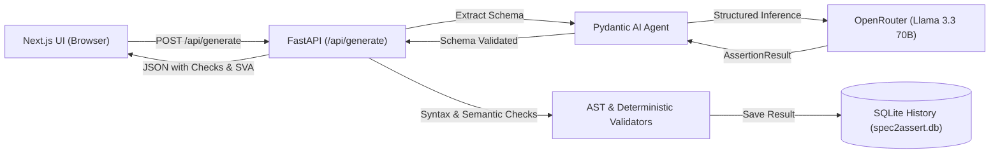

# Spec2Assert v2

> **Deterministic Natural-Language Hardware Protocol Assertion & Cocotb Synthesis**

Spec2Assert converts natural-language hardware protocol rules (e.g. AXI4, APB, FIFO invariants) into formal **SystemVerilog Assertions (SVA)** and executable **Python / cocotb** test stubs. Built to mirror modern verification workflows, it couples LLM-driven structured extraction with server-side AST checks and deterministic heuristics.

---

## Architecture

```
spec2assert/
├── BUILD_LOG.md               # Append-only engineering log tracking steps, errors & fixes
├── PROMPTS.md                 # Versioned LLM prompts & comparative benchmark results
├── README.md                  # Project overview & documentation
├── render.yaml                # Render backend deployment manifest
├── vercel.json                # Vercel frontend deployment manifest
├── scripts/
│   ├── log.sh                 # Bash logging helper for continuous audit
│   └── log.ps1                # PowerShell logging helper
├── backend/                   # REST API & LLM Orchestration
│   ├── app/
│   │   ├── main.py            # FastAPI routes, CORS, rate-limiting & lifespan
│   │   ├── models.py          # Pydantic schema contracts
│   │   ├── llm.py             # Pydantic AI agent connected via OpenRouter
│   │   ├── validators.py      # AST & regex deterministic structural checks
│   │   └── db.py              # SQLite compilation history storage
│   ├── tests/
│   │   ├── test_validators.py # Unit tests for structural checks
│   │   └── test_api.py        # API endpoint & history tests with mocked LLM
│   ├── evals/
│   │   └── run_eval.py        # Automated prompt benchmark harness
│   └── requirements.txt       # Python dependencies
└── frontend/                  # Modern Developer UI (Next.js + Tailwind CSS)
    ├── app/
    │   ├── page.tsx           # Interactive 2-column assertion workbench
    │   ├── layout.tsx         # Root dark theme layout
    │   └── globals.css        # Tailwind styling & dark theme variables
    ├── components/
    │   ├── Navbar.tsx         # Header & documentation links
    │   ├── MetadataBadges.tsx # Signal pills, clock domain & latency chips
    │   ├── ValidationChecklist.tsx # Pass/fail deterministic check matrix
    │   ├── CodeTabs.tsx       # SystemVerilog & cocotb tab viewer with copy
    │   └── HistoryList.tsx    # SQLite-backed compilation history sidebar
    ├── lib/
    │   └── api.ts             # Typed REST API client
    └── package.json
```

### Data Flow



---

## Features

- **Pydantic AI Structured Output:** Guarantees strict schema adherence (`rule_name`, `clock`, `reset`, `monitored_signals`, `formal_sva`, `python_test_stub`) with automated validation retries.
- **Deterministic Server-Side Verification:**
  - Python test stub parsed into an Abstract Syntax Tree (`ast.parse`) to prove valid Python code.
  - SVA checks for clocked `property ... endproperty` boundaries, explicit `assert property`, `disable iff` reset guards, and signal completeness.
- **Interactive Workbench UI:**
  - Two-column responsive developer layout.
  - Built-in bus presets for **AXI4 Handshake**, **FIFO Overflow**, and **APB Timeout**.
  - One-click copy for SystemVerilog code and cocotb test stubs.
  - Live pass/fail checklist of deterministic checks.
- **SQLite History Log:** In-memory or on-disk storage with fast retrieval of previous compilations.
- **Continuous Session Audit (`BUILD_LOG.md`):** Complete append-only audit trail logging every step, problem, fix, prompt refinement, and verification pass.

---

## Quickstart

### Prerequisites
- Python 3.11+
- Node.js 18.18+ (Node 20+ recommended)
- OpenRouter API key (or use built-in offline mock mode)

### 1. Backend Setup

```bash
cd backend
python -m venv .venv

# On Linux/macOS:
source .venv/bin/activate
# On Windows (PowerShell):
.venv\Scripts\Activate.ps1

pip install -r requirements.txt
cp .env.example .env
```

Configure your OpenRouter key in `backend/.env`:
```env
OPENROUTER_API_KEY=sk-or-v1-xxxxxxxxxxxxxxxxxxxx
MODEL_NAME=meta-llama/llama-3.3-70b-instruct
ALLOWED_ORIGINS=http://localhost:3000
DB_PATH=spec2assert.db
MOCK_LLM=false
```

Start the FastAPI backend:
```bash
uvicorn app.main:app --reload --port 8000
```
- API is running at: `http://localhost:8000`
- Interactive OpenAPI documentation: `http://localhost:8000/docs`
- Health check: `http://localhost:8000/health`

### 2. Frontend Setup

In a new terminal window:
```bash
cd frontend
npm install
npm run dev
```
Open `http://localhost:3000` in your browser.

---

## Running Backend Tests

Tests mock the LLM agent to run offline, fast, and free:
```bash
cd backend
pytest -q
```
Expected output:
```text
.........                                                                [100%]
9 passed in 2.27s
```

---

## Running the Prompt Benchmark Harness

To benchmark prompt iterations against 8 standardized protocol rules:
```bash
cd backend
python -m evals.run_eval
```

### Benchmark Results Summary (from `PROMPTS.md`)

| Version | Description | Pass Rate | Key Improvements |
|---|---|---|---|
| `v1` | Initial zero-shot system prompt | 4 / 8 (50.0%) | Base extraction |
| `v2` | Enforced clocked property blocks & disable iff | 7 / 8 (87.5%) | Added AST check & reset requirement |
| `v3` | Enforced self-contained cocotb harness & latency syntax | **8 / 8 (100.0%)** | Clean AST parse and full signal coverage |

---

## API Endpoints

### `POST /api/generate`
Compiles natural-language specification into assertions.
- **Request:**
  ```json
  {
    "spec": "When AXI valid is asserted, ready must assert within 3 clock cycles without valid dropping."
  }
  ```
- **Response:**
  ```json
  {
    "id": 1,
    "rule_name": "AXI4_HANDSHAKE_ASSERT",
    "clock": "clk",
    "reset": "!rst_n",
    "monitored_signals": ["valid", "ready"],
    "trigger_condition": "valid high and ready low",
    "expected_outcome": "ready asserted within 3 cycles",
    "max_latency_cycles": 3,
    "formal_sva": "property p_axi_handshake;\n  @(posedge clk) disable iff (!rst_n)\n  valid && !ready |-> (valid [*1:3]) intersect (##[1:3] ready);\nendproperty\nassert property (p_axi_handshake);",
    "python_test_stub": "import cocotb\n...",
    "explanation": "Prevents AXI protocol deadlock by enforcing ready response within 3 cycles.",
    "deterministic_check_passed": true,
    "checks": {
      "has_property_block": true,
      "has_assert_property": true,
      "uses_clock": true,
      "has_reset_disable": true,
      "references_all_signals": true,
      "cycle_bound_present": true,
      "python_stub_parses": true,
      "cocotb_imported": true
    }
  }
  ```

### `GET /api/history`
Returns list of the 10 most recent compilations.

### `GET /api/history/{id}`
Returns full assertion result by ID.

### `GET /health`
Returns system status and active prompt version.

---

## Known Limitations

| Limitation | Impact | Planned Resolution |
|---|---|---|
| **Deterministic Heuristics vs Formal Proof** | Regex checks catch structural omissions, not underlying logic flaws | Feed generated SVA directly into Verilator / SymbiYosys for formal syntax checking |
| **In-Memory Rate Limiting** | Resets on restart; not shared across multiple worker instances | Integrate Redis or distributed token bucket |
| **Ephemeral SQLite on Render Free Tier** | Database storage resets on inactive redeploys | Attach persistent disk or hosted PostgreSQL instance |
| **8-Spec Benchmark Suite** | Compact test suite | Expand to 50+ industrial protocol test cases |

---

## License

MIT License. Developed for PurpleCodeAI verification internship portfolio.
